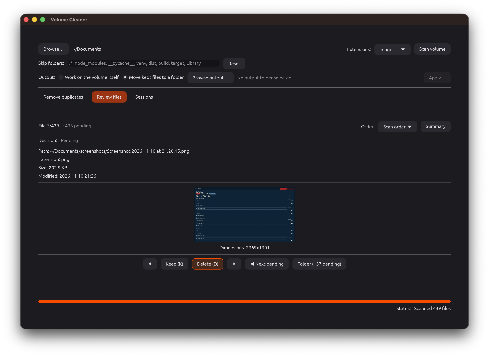
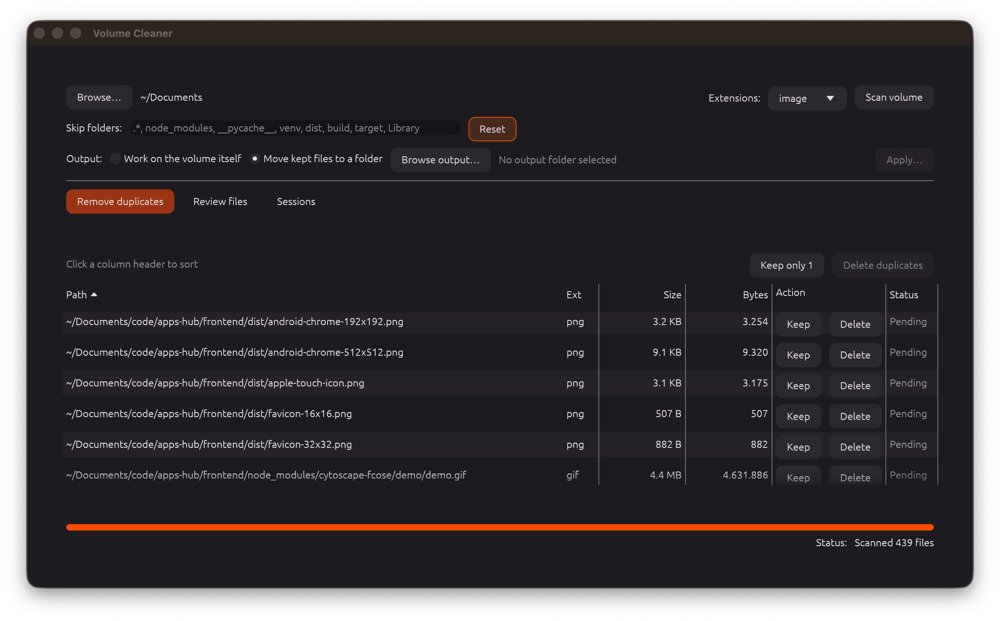
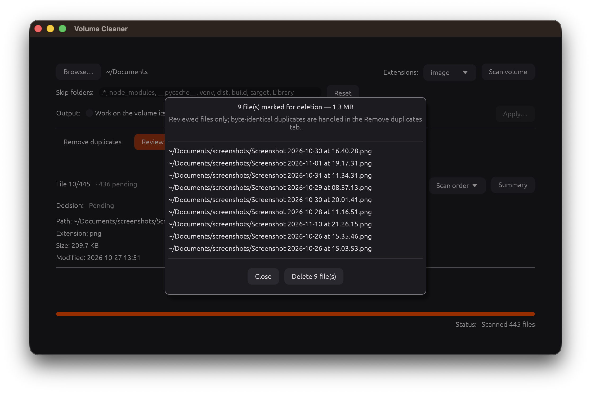
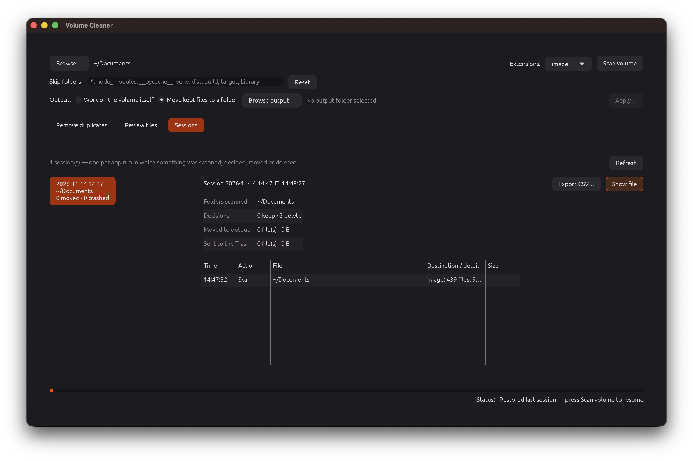

# Volume Cleaner

A multi-platform photo/video/document/file/etc. cleaner — built to prevent **digital Diogenes syndrome**: the quiet pile-up of duplicates, forgotten exports, and files you will never open again.

A Rust + egui GUI application to scan storage volumes, preview files, detect duplicates, and decide what stays so storage does not become a landfill.



<table>
  <tr>
    <td width="33%"></td>
    <td width="33%"></td>
    <td width="33%"></td>
  </tr>
  <tr>
    <td><b>Remove duplicates</b> — byte-identical copies, sortable by any column.</td>
    <td><b>Summary</b> — what is marked for deletion before anything goes to the Trash.</td>
    <td><b>Sessions</b> — every scan, move and deletion, per run.</td>
  </tr>
</table>

## Features

- **Multi-platform support**: Runs on ARM (Apple Silicon), x64, x86, and x32 architectures across Windows, Linux, and macOS.
- **Home-relative paths**: Listed paths replace the user home directory with `~` (`~/Documents/gifs/foto.jpg`). This is display-only; stored paths stay absolute. Home is taken from `HOME` on macOS/Linux and `USERPROFILE` on Windows. Separators are normalized to `/` in the `~` form so the same listing reads well on all three platforms.
- **Recursive file scanning**: List all files recursively from a selected directory or volume, with live progress feedback.
- **Skipped folders**: Folders that are almost never personal files are skipped while scanning. The default list is `.*` (every hidden folder, e.g. `.git`, `.venv`), `node_modules`, `__pycache__`, `venv`, `dist`, `build`, `target`, and `Library`. Names match exactly, ignoring case. The list is editable in the "Skip folders" field and remembered between runs; "Reset" restores the defaults.
- **File type filtering**: Group and filter by extensions:
  - 🖼️ Images (jpg, jpeg, png, webp, gif, bmp, heic, heif)
  - 🎥 Videos (mp4, mkv, mov, avi, webm)
  - 📄 Documents (pdf, txt, md, doc, docx, odt)
  - 🎵 Audio (mp3, flac, wav, aac, ogg, m4a)
  - ✏️ Custom: user-specified extensions (e.g., `psd, raw` or `.psd .raw`)
- **Duplicate detection**: Files are first grouped by size, then by a partial hash of their first bytes, and only real candidates get a full SHA-256 hash, so large files are not all hashed up front. The **original** is the first occurrence found during the scan. In the Remove duplicates tab you mark Keep or Delete per row, or click "Keep only 1" to mark every copy except the first of each group for deletion. "Delete duplicates" then sends every marked duplicate to the system Trash, after a confirmation modal listing exactly which files and how much space. A group of identical files is never left without a copy: if every copy is marked, the first one is kept. Each duplicate is re-hashed right before deletion and skipped if it changed since the scan.
- **One-at-a-time review**: Go through files one by one and press `K` (keep) or `D` (delete), or click the buttons; each decision advances to the next file. `←` / `→` (or ⏴ / ⏵) move without deciding, and `N` (or "⏭ Next pending") jumps to the next file without a decision. The **Order** menu walks files in scan order, newest or oldest first, largest first, or by folder. The **Folder** menu marks every pending file in the current file's folder as Keep or Delete at once. Duplicates show a warning, since they are deleted from the Remove duplicates tab.
- **Review summary**: The "Summary" button in the Review files tab lists every reviewed, non-duplicate file marked for deletion, with a count and total size. "Delete N file(s)" sends them to the Trash after a second confirmation step.
- **Two output modes**: work on the volume itself (files marked delete go to the Trash, everything else stays where it is), or pick an **output folder** and click **Apply…** to move every kept file to `<output>/<category>/<relative path>` (`image`, `video`, `audio`, `documents`, `other`) and send files marked delete to the Trash. See [Output folder mode](#output-folder-mode).
- **Session history**: Every run of the app is a session. The **Sessions** tab lists them and shows, for each one, the folders scanned, how many Keep/Delete decisions were made, and every file moved, sent to the Trash, skipped or failed, with time, destination and size. Any session can be exported to CSV. See [Session history](#session-history).
- **Resumable review**: Keep/delete decisions and your position are saved per scanned folder, and the last folder, filter, skipped folders and output settings are remembered. Scan the same folder again to continue where you left off. See [Stored data](#stored-data).
- **Preview capabilities**:
  - Images: preview that scales with the window, plus size, modified date (local time), and pixel dimensions.
  - HEIC/HEIF (iPhone photos): previewed on macOS by converting a copy to JPEG with the built-in `sips` tool (cached). On Windows and Linux they show "Reveal in file manager".
  - Plain text (`.txt`, `.md`): scrollable monospace preview.
  - Other formats: "Reveal in file manager" button to locate and open externally (Finder/Explorer/`xdg-open`).
- **Exit confirmation**: Closing the window asks for confirmation before quitting.
- **Future roadmap**: see [Roadmap](#roadmap) below — thumbnail grid, video/PDF previews, perceptual hashing, cloud storage cleanup.

## Tech Stack

- **Language**: Rust
- **GUI Framework**: [egui](https://github.com/emilk/egui) (via `eframe`), with a custom dark "Rust orange" Material-inspired theme
- **Image decoding/display**: `egui_extras` (image loaders, WebP/GIF support), backed by the `image` crate; HEIC via macOS `sips`
- **File hashing**: `sha2` (SHA-256) for duplicate detection and copy verification
- **Deletion**: `trash` — files go to the system Trash / Recycle Bin instead of being removed outright
- **Directory traversal**: `walkdir`
- **Native folder picker**: `rfd`
- **App data location**: `dirs`
- **Session history**: `serde` / `serde_json` (JSON files), `chrono` (local time)
- **Free-space check**: `fs4`
- **Cross-platform**: Built to run natively on all major OS and CPU architectures

Video playback, PDF rendering, and syntax-highlighted text are **not implemented yet** — they're tracked in the [Roadmap](#roadmap) and will bring their own dependencies when they land.

## Why Rust + egui?

Volume Cleaner spends most of its time on I/O-heavy work — recursive scans, hashing large files, copying or deleting them — and the rest on a tight review loop: preview a file, decide keep or delete, move on. Rust plus egui (via eframe) cover both sides in one native binary.

- **Performance without a runtime**: Hashing and scanning large volumes stay fast and predictable. There is no garbage collector pausing the UI while a multi-gigabyte file is hashed.
- **Memory safety for dangerous operations**: Cleanup removes files from their source folder. Rust's type system and ownership model reduce the class of bugs (use-after-free, data races, unchecked buffer issues) that are especially costly in a tool that mutates the filesystem.
- **Safe concurrency**: The scan and hashing pipeline runs on a background thread and streams progress back to the UI over a channel, keeping the window responsive.
- **One language, one process**: UI state, file I/O, hashing, and previews live in the same Rust binary. No Electron/JS bridge, no separate backend, no FFI tax between the scan pipeline and the review screen.
- **Immediate-mode fits the workflow**: The one-at-a-time review is a tight loop (show file → shortcut → next). Immediate-mode UI redraws from current state each frame, which maps cleanly to "one candidate at a time".
- **Native and lightweight**: One codebase produces small, standalone executables for Windows, Linux, and macOS — including ARM (Apple Silicon) and x86/x32. egui renders natively on every target, without Qt or Electron.

## Architecture

The application is organized as a small set of flat modules:

```
volume-cleaner/
├── src/
│   ├── main.rs          # Application entry point — wires up the modules and runs the GUI
│   ├── gui.rs           # eframe::App implementation: theme, header, tabs, modals, footer
│   ├── filesystem.rs    # Scanning (with skipped folders), duplicate detection,
│   │                    # home-relative paths, review-state and last-session persistence
│   ├── config.rs        # `Extensions` presets (image/video/audio/documents) and category lookup
│   ├── output.rs        # Verified copy (.part + SHA-256), hash-checked trash, Apply batch
│   ├── history.rs       # Session history: recorder, JSON storage, totals, CSV export
│   └── platform.rs      # Reveal in file manager; HEIC → JPEG preview conversion (macOS)
├── Cargo.toml
└── README.md
```

### Module Responsibilities

- **`gui`**: Owns all `eframe::App` state and rendering:
  - **Header**: folder picker, extension filter, "Skip folders" field, output mode, "Apply…".
  - **Remove duplicates** tab: sortable table (Path / Ext / Size / Bytes / Action / Status), "Keep only 1", "Delete duplicates".
  - **Review files** tab: metadata, preview, decision status, order menu, ⏴ / Keep / Delete / ⏵ / Next pending / Folder controls, Summary modal.
  - **Sessions** tab: list of sessions and the detail of the selected one.
  - Exit confirmation and the footer progress bar/status line.
  - Scans and Apply batches run on background threads polled through `mpsc` channels.
- **`filesystem`**: Walks a directory (`walkdir`), skipping excluded folders, filters by extension, and produces `Entry` values (path, size, extension, modified time). Detects duplicates by size, then partial hash, then full SHA-256. Also owns home-relative path display, the app data folder, and the persistence of review decisions and the last-used settings.
- **`config`**: Defines the built-in extension presets and maps an extension to a `FileCategory` so the review screen can pick the right preview widget and Apply can pick the output category folder.
- **`output`**: Builds `<output>/<category>/<relative path>` destinations, validates the output folder, checks free space, copies files safely (`.part`, SHA-256 check, rename, never overwrite), sends files to the Trash after re-checking their hash, and runs the Apply batch with cancel support.
- **`history`**: Records the current session (scans, decisions, moved/trashed/skipped/failed files) and saves it as JSON after every change. Also loads past sessions, computes their totals, and exports any session to CSV.
- **`platform`**: Opens the OS file manager at a given path (`open -R` on macOS, `explorer /select,` on Windows, `xdg-open` on the parent directory on Linux), and converts HEIC/HEIF to a cached JPEG for preview on macOS.

## How It Works

1. **Select source volume/directory**: Click "Browse…" to choose a folder (or let it be pre-filled from your last session).
2. **Configure filters**: Pick a preset (image/video/audio/documents) or "custom" with your own extensions, adjust "Skip folders" if needed, then click "Scan volume".
3. **Scan and hash**: Files are listed recursively and duplicates are detected via partial-then-full hashing, with progress shown in the footer.
4. **Review files**:
   - **Remove duplicates** tab: byte-identical copies only. Click a column header to sort (again to reverse), mark Keep/Delete per row or use "Keep only 1", then "Delete duplicates" to send the marked copies to the Trash after confirming. At least one copy of each group always stays.
   - **Review files** tab: every scanned file, one at a time. `K` / `D` decide and advance, `←` / `→` move without deciding, `N` jumps to the next pending file. Use **Order** to review newest, oldest or largest files first, and **Folder** to decide a whole folder's pending files at once. "Summary" lists what is marked for deletion and can send it to the Trash.
   - Unsupported formats show "Reveal in file manager" instead of a preview.
5. **Apply (output folder mode only)**: choose "Move kept files to a folder", pick the output with "Browse output…", then click **Apply…**. A confirmation modal shows how many files will be moved, sent to the Trash, and left untouched, plus the free space in the output volume.
6. **Check what happened**: the **Sessions** tab shows every file moved or deleted in each run, and can export it to CSV.
7. **Resume later**: decisions and review position are saved automatically as you go.

## Stored data

Everything the app remembers lives in the per-user data folder, so it works the same however the app is launched (terminal, Finder, Explorer):

| OS | Folder |
|---|---|
| macOS | `~/Library/Application Support/volume-cleaner/` |
| Windows | `%APPDATA%\volume-cleaner\` |
| Linux | `~/.local/share/volume-cleaner/` |

- `last_session.tsv` — last scanned folder, extension filter, custom extensions, skipped folders, output mode and output folder, so they're pre-filled next time.
- `state/<hash-of-folder-path>.tsv` — one file per scanned folder with every file's keep/delete decision and the current review position.
- `sessions/<YYYYMMDD-HHMMSS>.json` — the session history (see below).

Review state is applied by matching absolute file paths after a fresh scan, so to resume you scan the same folder again — the app does not auto-scan on launch.

Earlier versions stored this in a `session/` folder relative to the working directory. On first launch, if that folder exists and the new location is still empty, its contents are copied over automatically.

HEIC previews are cached in the OS cache folder (`~/Library/Caches/volume-cleaner/heic/` on macOS) and can be deleted at any time.

## Session history

Each run of the app is one **session**. It is saved to `sessions/<id>.json` as soon as something happens, and updated after every change. Opening and closing the app without doing anything leaves no file.

A session records:

- **Scans**: folder, filter, number of files and duplicates found.
- **Decisions**: how many files were marked Keep and Delete (counts, not one entry per keypress).
- **Moved**: source path, final destination and size (output folder mode).
- **Trashed**: path, size, and where it was deleted from ("Delete duplicates", "Summary" or "Apply").
- **Skipped**: duplicates not deleted because they changed since the scan.
- **Failed**: path and the error (locked file, missing permission, copy verification failed…).

The **Sessions** tab lists every session, newest first, with its folders and how many files were moved and trashed; the current one is marked "(this session)". Selecting a session shows its totals and a table of every event (time, action, file, destination or detail, size).

- **Export CSV…** writes `time,action,path,destination_or_detail,size_bytes` with full paths and ISO-8601 local timestamps.
- **Show file** reveals the session's JSON file.

Files sent to the Trash can be restored from the system Trash / Recycle Bin while it hasn't been emptied; the history tells you exactly which files and where they came from.

## Keyboard Shortcuts

| Key | Action | Where |
|-----|--------|-------|
| `K` | Keep the current file and move to the next | Review files tab |
| `D` | Mark the current file for deletion and move to the next | Review files tab |
| `←` | Go to the previous file without changing its decision (also the ⏴ button) | Review files tab |
| `→` | Go to the next file without changing its decision (also the ⏵ button) | Review files tab |
| `N` | Jump to the next file without a decision (also "⏭ Next pending") | Review files tab |

"Next" and "previous" follow the order selected in the **Order** menu. Shortcuts are ignored while a text field (e.g. the custom-extensions or skip-folders box) has keyboard focus.

## System Requirements

- **Operating Systems**: Windows 10+, macOS 10.15+, Linux (modern distributions).
- **Architectures**: ARM64 (Apple Silicon), x64, x86, x32.
- **Memory**: Minimum 512 MB RAM recommended for large file sets.
- **Disk Space**: In output folder mode, the output volume needs room for every kept file (Apply checks this before starting). Originals go to the Trash, so they keep using space on the source until you empty it.

### Home directory (`~`)

The `~` prefix in the UI is a **display** convention, not a rewrite of `Entry.path`.

| | macOS / Linux | Windows |
|--|----------------|---------|
| Home variable | `HOME` (`/Users/you`) | `USERPROFILE` (`C:\Users\you`) |
| `~` on screen | yes | yes (`~/Documents/...`) |

Matching uses `Path::strip_prefix`, so Windows backslashes still count as home. On Windows the comparison is case-sensitive: if a path is `c:\...` and `USERPROFILE` is `C:\...`, the substitution may be skipped.

## Installation

```bash
git clone https://github.com/your-username/volume-cleaner
cd volume-cleaner
cargo build --release
```

Run the binary from `target/release/volume-cleaner` (or `volume-cleaner.exe` on Windows).

## Building per platform

Every build needs a Rust toolchain installed with [rustup](https://rustup.rs). The table lists which host can produce which binary:

| Build host ↓ / Target → | Linux | Windows | macOS |
|---|---|---|---|
| **Linux / WSL (Ubuntu)** | ✅ Native | ✅ Cross (MinGW or `cargo-xwin`) | ❌ Not supported |
| **Windows** | ✅ Through WSL | ✅ Native (MSVC) | ❌ Not supported |
| **macOS** | ❌ Not covered | ❌ Not covered | ✅ Native (Apple Silicon, Intel, Universal) |

To build for macOS you need Apple's SDK, so macOS binaries have to be built on a Mac (or a macOS CI runner).

Each OS produces its own binary, so don't share the `target/` folder between Windows and WSL. Move the source with git instead (`git push` / `git pull`) and build on each side.

### Linux / WSL (Ubuntu)

```bash
# Toolchain (only once)
curl --proto '=https' --tlsv1.2 -sSf https://sh.rustup.rs | sh
source ~/.cargo/env
sudo apt install build-essential pkg-config
```

**Linux binary (native)**

```bash
cargo build --release
# → target/release/volume-cleaner
```

Under WSL the window opens through WSLg (Windows 11, or Windows 10 with WSLg). `rfd` uses the XDG desktop portal for the "Browse…" dialog. If the dialog does not appear, install the portal:

```bash
sudo apt install xdg-desktop-portal xdg-desktop-portal-gtk
```

**Windows `.exe` (cross-compiled, GNU toolchain)** — the simplest option:

```bash
sudo apt install mingw-w64
rustup target add x86_64-pc-windows-gnu
cargo build --release --target x86_64-pc-windows-gnu
# → target/x86_64-pc-windows-gnu/release/volume-cleaner.exe
```

**Windows `.exe` (cross-compiled, MSVC toolchain)** — the same ABI as a native Windows build, using [`cargo-xwin`](https://github.com/rust-cross/cargo-xwin):

```bash
cargo install --locked cargo-xwin
rustup target add x86_64-pc-windows-msvc
cargo xwin build --release --target x86_64-pc-windows-msvc
# → target/x86_64-pc-windows-msvc/release/volume-cleaner.exe
```

Executables copied out of `\\wsl$\…` may be flagged by Windows SmartScreen ("Windows protected your PC") because they are unsigned and carry a downloaded-file mark. Choose **More info → Run anyway**, or unblock them with PowerShell's `Unblock-File`.

### Windows

1. Install [rustup-init.exe](https://rustup.rs) and the **Visual Studio Build Tools** with the *Desktop development with C++* workload.
2. Clone the repository into a Windows folder, not under `\\wsl$\…` (building there is very slow).
3. Build:

```powershell
cargo build --release
# → target\release\volume-cleaner.exe   (x64)
```

Other Windows architectures (install the matching MSVC build tools component for each):

| Architecture | Command |
|---|---|
| x64 | `cargo build --release` |
| ARM64 | `rustup target add aarch64-pc-windows-msvc` then `cargo build --release --target aarch64-pc-windows-msvc` |
| x86 (32-bit) | `rustup target add i686-pc-windows-msvc` then `cargo build --release --target i686-pc-windows-msvc` |

To get a Linux binary from Windows, open a WSL terminal and follow the [Linux / WSL](#linux--wsl-ubuntu) steps.

Release builds hide the console window (`windows_subsystem = "windows"` in `main.rs`). Debug builds keep it open so `println!` output and panics stay visible.

### macOS

```bash
xcode-select --install                     # Command Line Tools (only once)
curl --proto '=https' --tlsv1.2 -sSf https://sh.rustup.rs | sh
```

| Target | Command | Output |
|---|---|---|
| Native (current Mac) | `cargo build --release` | `target/release/volume-cleaner` |
| Apple Silicon | `cargo build --release --target aarch64-apple-darwin` | `target/aarch64-apple-darwin/release/volume-cleaner` |
| Intel | `cargo build --release --target x86_64-apple-darwin` | `target/x86_64-apple-darwin/release/volume-cleaner` |

Universal binary (runs on both Apple Silicon and Intel):

```bash
rustup target add aarch64-apple-darwin x86_64-apple-darwin
cargo build --release --target aarch64-apple-darwin
cargo build --release --target x86_64-apple-darwin
lipo -create -output volume-cleaner \
  target/aarch64-apple-darwin/release/volume-cleaner \
  target/x86_64-apple-darwin/release/volume-cleaner
```

### Troubleshooting: `wgpu-hal` fails to compile on Windows

If a Windows build fails inside `wgpu-hal` with errors such as `expected ID3D12Device, found Direct3D12::ID3D12Device` and the note *"multiple different versions of crate `windows`"*, then `Cargo.lock` has pinned `gpu-allocator` to an older `windows` crate. Unify it with:

```bash
cargo update -p windows@0.58.0 --precise 0.62.2
```

The `Cargo.lock` in this repository already includes this fix.

### Pre-built Binaries

Pre-compiled binaries for common platforms will be available in the [Releases](https://github.com/your-username/volume-cleaner/releases) section.

## Roadmap

- [x] Copy-then-delete cleanup workflow: move kept files to an output folder (see [Output folder mode](#output-folder-mode)).
- [x] Restore deleted files (via the system Trash / Recycle Bin).
- [x] Operation log export: per-session history with CSV export (see [Session history](#session-history)).
- [x] Skip development/system folders while scanning.
- [x] HEIC/HEIF support (preview on macOS).
- [ ] Thumbnail grid view to decide many photos at once.
- [ ] Video thumbnail/playback preview (e.g. `egui-video`).
- [ ] Perceptual hashing for near-duplicate images (bursts, resized or re-compressed copies).
- [ ] Organize output by date taken (EXIF), e.g. `<output>/image/2024/…`.
- [ ] PDF page-by-page preview.
- [ ] Syntax-highlighted preview for code files.
- [ ] HEIC preview on Windows and Linux.
- [ ] Cloud integration (iCloud, Google Photos).
- [ ] Light theme toggle (currently dark-only).

## Output folder mode

The header lets you choose where kept files end up:

- **Work on the volume itself** (default): nothing is copied. Files marked delete are sent to the Trash from the Summary modal or with "Delete duplicates".
- **Move kept files to a folder**: pick an output folder, review as usual, then click **Apply…**. The mode and output folder are remembered between runs.

What **Apply** does, as one batch with a progress bar in the footer:

- **Kept files** (reviewed and not marked delete, plus the copy that survives from each duplicate group) are moved to `<output>/<category>/<path relative to the input folder>`, e.g. `<output>/image/2019/Trip/IMG_0001.jpg`. The category comes from the extension presets; extensions outside them go to `other/`.
- **Files marked delete** (reviewed files and surplus duplicates) are sent to the Trash. A duplicate group always keeps at least one copy, and duplicates are re-hashed first: one that changed since the scan is skipped.
- **Unreviewed files** are left untouched in the source.
- Kept files are moved first, then deletions run.
- Every file moved, trashed, skipped or failed is recorded in the [session history](#session-history).

How a file is moved safely:

1. It is copied to `<dest>.part`.
2. The SHA-256 of the copy is compared with the original.
3. The copy is renamed to its final name.
4. Only then is the original sent to the Trash.

If the app is closed or the batch stops midway, the original is still in the source; at most a `.part` file is left behind. Existing files are never overwritten: if the destination already holds the same content (e.g. from an interrupted run), it is reused; if it holds different content, the copy is renamed `IMG_0001 (1).jpg`. **Stop** finishes the current file and stops; files already processed disappear from the list, and running Apply again continues with the rest.

Safety checks before Apply can start:

- The output folder must exist and cannot be the input folder or inside it.
- The output volume must have enough free space for every file to be moved.

### Still pending

- Store review state inside `<output>/.volume-cleaner/` so the output folder is self-contained.

## Contributing

Contributions are welcome! Please open an issue or submit a PR for bugs, features, or improvements.

## License

MIT

---

**Note**: This tool modifies files on your system. Always back up important data before cleaning. Nothing is deleted outright: "Delete duplicates", the Summary modal and Apply all send files to the system Trash / Recycle Bin (restorable until you empty it), always after a confirmation modal, and a group of identical files always keeps one copy. Pressing Delete (D) in the Review files tab only records the decision. The **Sessions** tab lists every file that was moved or deleted in each run.
